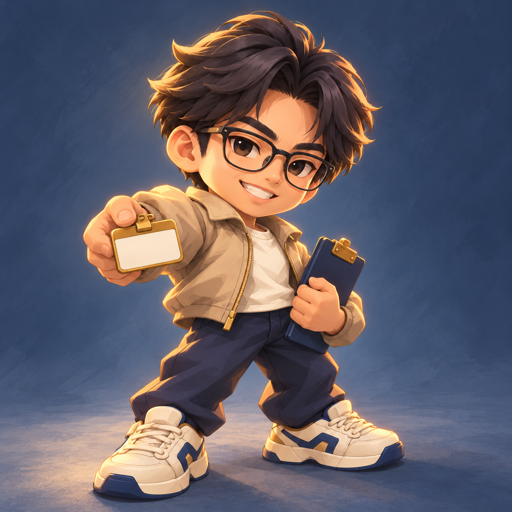

# Brandon — 3D asset production specification

Version 0.3 · October 29, 2026 · **Production plan; target asset not yet built**

## Purpose and authority

Build Brandon for GOC Royale as a painterly, anime-inspired chibi 3D fighter, with a shaped expressive face, articulated five-finger hands, convincing clothing and dynamic game animation.

This is the individual production document for Brandon's next asset revision, following [the shared character pipeline](CHARACTER_3D_PIPELINE.md). The same staged quality requirements apply to all seven fighters. [Performance and gameplay standards](PERFORMANCE-AND-GAMEPLAY-STANDARDS.md), especially sections 7.3 and 11–12, govern runtime budgets and acceptance. Detailed source rigs may exceed runtime complexity; that does not approve larger live-game exports. Any runtime-budget exception requires written rationale, measured evidence and an explicit user decision. No exception is approved by this document. It supersedes the earlier Brandon-specific suggestions for mitten hands, a static graphic face and a simple smooth jacket. [Art and audio direction](ART-AND-AUDIO-DIRECTION.md) continues to govern the wider game; [the previous redesign brief](BRANDON-REDESIGN-BRIEF.md) preserves the development history. Existing gameplay rules are unchanged.

**Working visual target:** the second, compact concept generated October 29. It is a proposal for likeness, proportions and finish, not a finished mesh, an approved turnaround, or proof of achievable runtime quality. Exact proportions and material treatment remain subject to visual review.

## 1. Character and visual direction

| Element | Requirement |
| --- | --- |
| Identity | Brandon's recognizable center-parted dark hair, fitted black rectangular glasses and friendly, confident expression. Use supplied photos where available; a generated concept is not an exact likeness source. |
| Proportions | Start near 2.8–3.2 heads tall. Compact athletic torso, short articulated limbs, readable hands and larger sneakers. Review front and profile before fixing the ratio. |
| Face | Deliberately shaped cheeks and jaw, small integrated nose, modeled eyelids and lips, a usable mouth opening/interior. Expressive anime simplification; no skin pores, uncanny realistic eyes or oversized staring toy eyes. |
| Hair | A coherent silhouette with a recognizable center part and a small number of shaped sweeping locks. Broad planes and highlights; no individual strand simulation or stacked primitive blobs. |
| Outfit | Sand-beige jacket, warm cream tee, dark navy trousers and cream sneakers with restrained navy/ochre accents. Gold only on small clips/zipper details. |
| Props | Separate clipboard and nametag with credible thickness and surfaces for the fingers to grip. No text that becomes illegible during gameplay. |
| Finish | Painterly color variation, grouped shadows, selective soft transitions and controlled highlights. Fabric, skin, hair, glasses and metal must read differently. |
| Silhouette | Readable in a close menu view and the actual overhead game camera. No exposed assembly joints or unintended block shapes. |
| Personality | Welcoming, alert and playful. Confident active poses, clear hand gestures and body participation in actions. |

The fantasy references inform shape, shading and light grouping. Their armor, wings, halos and setting are not Brandon's costume. Preserve readability over fine-detail imitation of the generated image.

Starting palette: jacket `#D4B78F`, shirt `#F5EDDA`, cuffs `#A98B68`, hair/glasses `#29272B`, trousers near `#293446`. These are look-development starting values, not final calibrated material colors.

## 2. What exists today

The [v4 movement study](../assets/3d/brandon-v4/README.md) is useful evidence of articulated limbs and browser export. It is **not** the production asset for this concept.

| Existing evidence | Remaining gap |
| --- | --- |
| Full-body 26-bone FK rig, blended skinning and four bend-support bones | Refit to revised proportions; add finger, face, foot-control and garment needs |
| Continuous sleeve and trouser meshes | Purpose-built garment shapes, thickness, folds, UVs and textures |
| Mitten hands and head-mounted facial graphics | Separate fingers, modeled facial structure and expressive deformation |
| Idle and joint-demo clips | Dynamic locomotion, grip/release, combat and Broomball clips |
| Passing export/re-import comparison | Repeat on every new mesh, rig, texture and animation revision |
| No within-mesh crossings at sampled demo frames | Deep-bend flags, incomplete numerical shoulder coverage, cross-mesh contacts and foot planting still need work |

Measured v4 export: 64,112 triangles, 26 bones, 11 materials and 1,875,980 bytes. These are historical measurements, not targets for the new asset. No phone performance claim follows from them.

Preserve `assets/3d/brandon-v4/` and its browser asset. Develop the new asset in `assets/3d/brandon-v5/`, with renders/reports in `outputs/brandon-v5/` and candidate browser exports in `client/public/art3d/brandon-v5/`. The v5 source and review folders now contain a primary-form study; the candidate browser-export folder remains planned. Replace a game asset only after the integration checks below.

## 3. Production passes

Each pass produces an inspectable artifact and an evidence-based exit condition. Passes are not an excuse to restart or discard good work. If a later test reveals an upstream problem, fix the mesh, rig or material responsible and repeat the affected checks.

| Pass | Work and deliverable | Exit condition |
| --- | --- | --- |
| **0 — Reference and proportions** | Front, profile, back and three-quarter design guides; neutral full-body silhouette; face, garment and prop callouts. Establish grip hand and throwing hand. | Views describe one consistent character. Head ratio, likeness cues, jacket cut and prop scale are recorded. Generated-image inconsistencies are resolved. |
| **1 — Primary sculpt** | Shaped full body, face and hair; separate garment volumes; anatomical palm and five fingers on each hand. Neutral gray renders before texturing. | Likeness and silhouette work without flattering lighting. Head has a credible profile; fingers/thumb and shoulder/hip volumes are intentionally shaped. |
| **2 — Garments and secondary forms** | Jacket construction, collar, cuffs, hem, pockets, major folds, trousers and shoe structure. Separate clipboard/nametag fitted to actual hands. | Folds correspond to tension, compression and gravity. Seams and garment thickness are intentional. Props and hands fit at the designed scale. |
| **3 — Deforming game mesh and initial rig** | Clean lower-density mesh, joint/face/finger loops, usable UV layout, fitted body/finger/face rig and initial weights. Test neutral and stressed poses. | No unweighted vertices, normalized weights, at most four influences. No unexplained opposite-side movement. Both hands grip props and the shoulders/elbows/knees deform acceptably. |
| **4 — Textures and browser look development** | Bake necessary sculpt detail; paint coherent color/roughness textures; create a browser material test under neutral and game lighting. | Face, fabric, hair and props read distinctly in-browser. Required shader behavior is implemented there. No dependence on a Blender-only beauty render. |
| **5 — Face, hand and sleeve proof** | Short close-up performance: grip clipboard, bend elbow, raise shoulder, blink and smile; nametag grip/release test. Export and replay in-browser. | Fingers make convincing contact, prop does not slide, facial features deform coherently, and garment folds survive motion. Inspect transitions as well as endpoints. |
| **6 — First gameplay animations** | Polished idle, in-place forward run and tag throw; representative blends and cloth follow-through. | Feet contact the ground, poses have weight, hand paths are intentional, prop attachments are stable, and attack timing matches the simulation. |
| **7 — Optimization and game integration** | LOD candidate if needed, measured asset manifest, remaining required states, test with multiple fighters and game UI. | Export round-trip, browser playback, actual multiplayer presentation and named physical-phone performance checks pass. No gameplay rule changes are hidden in animation. |

Early rig experiments can begin during passes 1–2 to expose impossible proportions or garment shapes. Do not spend time finishing tiny wrinkles before the silhouette and bending requirements work. Pass 4 starts with a small material sample; it need not wait for every texture to be painted.

Review checkpoints are **proportions/likeness (pass 1)**, **the close-up performance proof (pass 5)** and **first gameplay animation set (pass 6)**. Present the actual result and unresolved issues at those points. These are review opportunities, not a requirement to request permission for every reversible edit. Do not describe an unreviewed proposal as user-approved.

## 4. Clothing construction and movement

The goal is believable stylized fabric, with deliberately simplified detail at game scale.

| Feature | Implementation | Validation |
| --- | --- | --- |
| Collar, cuffs, hem, pockets and silhouette folds | Modeled garment geometry; thickness where edges are visible | Front/profile close-ups, raised shoulder and bent elbow |
| Fine seams and shallow creases | Painted texture and baked normal detail where useful | Readable at menu size, no noisy aliasing at gameplay size |
| Compression and stretch folds | Suitable topology, compatible skin weights and a small set of pose corrections | Moving elbow, shoulder, hip and knee through intended ranges |
| Jacket hem/collar follow-through | Authored helper-bone motion, with corrections where needed | Turns, starts/stops and attack recovery without body penetration |
| Draping reference | Optional offline cloth experiment in Blender | Use it to inform shape; do not assume its simulation cache is a portable game animation |

Large folds must agree with where the cloth is held: elbow creases on the inside of a bend, tension from raised shoulders, gathering at cuffs and gravity-led hanging folds. Avoid permanently sculpting a strongly bent-arm crease into the neutral pose. Correctives may be bone-based or mesh shape keys, but their exported result must be tested.

First playable version uses authored garment motion. Runtime cloth physics is not required for this target and is outside the first milestone. If cloth simulation is used during authoring, convert the chosen result into the supported game representation and verify it; do not promise direct cache-to-GLB export.

Hide or remove body surfaces permanently covered by clothes only after checking neckline, cuffs, hem and motion. Cross-mesh penetration checks must include the garment/body boundary and both sides of every visible opening.

## 5. Face and hair

- Model the head volume, cheeks, jaw, nose, lips and eyelids; the mouth needs enough interior geometry for the chosen expressions. Simple teeth/tongue shapes are sufficient initially.
- Plan loops around eyes and mouth for deformation. The eyelids must close over the eye surface without exposing gaps, and the lips must close cleanly.
- Minimum expression set: neutral, blink left/right, friendly smile, narrowed confident eyes, brow raise/lower, jaw open and a hit reaction. These are requirements to build, not claims that shapes exist.
- Use a hybrid of joints and shape keys where appropriate. Inspect left/right symmetry and asymmetric expressions; reject empty placeholder shape keys.
- Fit glasses in profile and three-quarter views. Attach frames to the head; keep brows/eyelids from clipping through frames. Prefer readable frames without costly or distracting transparent lenses.
- Hair locks must join into a coherent hairstyle with clear roots, part and flow. Stable sculpted hair is the initial implementation; any animated lock needs explicit motion and clipping checks.

The first facial deliverable is a blink and smile on the actual model, shown close-up and exported. An attractive still face alone does not pass.

## 6. Hands, grips and props

Each hand requires **four separate fingers and an opposable thumb**, a shaped palm and sufficient knuckle/web topology. Use articulated finger chains appropriate to the stylized anatomy, including a thumb base that can oppose the fingers. Do not force a fingerless fallback to satisfy an obsolete bone budget.

Working staging proposal: right hand throws a nametag, left hand carries the clipboard. It remains adjustable during pose review and is not a claim about Brandon's real handedness.

Required poses: relaxed hand, open hand, clipboard grip, nametag pinch and release. Fingers should wrap around the actual object thickness; inspect fingertips, thumb contact and the palm/object gap. A generic closed fist does not establish a usable grip.

Use named left/right hand attachment points with prop-specific offsets. While held, a prop follows the grip hand. At a gameplay release event, presentation changes ownership/visibility consistently with the simulation; a hand animation must not independently create a damaging projectile. In multiplayer, preserve host authority and existing prediction rules.

Proof: close-up grip held during an arm lift and torso turn, then a controlled release. No visible prop sliding, passing through fingers or abrupt attachment jumps. Check both hands even if only one throws.

## 7. Rig and motion requirements

Authoring controls may be richer than the exported skeleton. Provide IK foot controls for planted contacts, usable arm controls, individual finger posing and accessible facial controls. Export only necessary deform bones/attachments and supported animation data; bake controller/constraint results. Standard linear skinning is the validation baseline.

Retain a stationary gameplay root for in-place clips. The animated visual body may shift and lean, but cannot move hitboxes, change attack range or add an unapproved attack delay. Expressive anticipation must fit around immediate gameplay response and the actual release event.

First animation set:

| Clip | Quality criteria |
| --- | --- |
| Idle | Asymmetric relaxed posture, subtle breathing, stable feet and occasional purposeful expression |
| Forward run | Forward intent, opposing shoulder/hip motion, planted contacts, controlled bounce, believable hand and clipboard arcs |
| Tag throw | Clear torso/shoulder contribution, finger release, readable silhouette and brief follow-through; blends with locomotion |

After those pass, add backward/strafe locomotion, Welcome Super, hit, stun, elimination/respawn, victory/defeat and Broomball carry/shoot states. Do not copy the older prototype's clip count as evidence that the new rig has those clips.

## 8. Surface style and game rendering

The concept is a visual target, not a literal material recipe. Use painted hue/value variation and broad sculpted planes, then develop lighting that groups forms into clear light/shadow regions. Avoid baking a fixed golden studio rim or cast shadow into the base color; those would remain incorrectly attached when the fighter turns.

Start with portable base-color, roughness and normal textures in a regular metallic/roughness GLB. Keep cloth/skin nonmetallic and reserve metal for appropriate small fittings. If a toon lighting ramp or outline is needed to match the target, build and document its browser material implementation during pass 4. Arbitrary Blender shader nodes do not constitute an implemented browser shader.

Review materials under neutral lighting, the menu showcase, and the actual arena camera. Do not use postprocessing to conceal shape or weighting problems. Fine texture detail must remain subordinate to face readability, team markers and ability effects.

## 9. Provisional production budgets

These targets distinguish detailed authoring assets from the mandatory live-game limits. Preserve expressive face and hand performance through a tested optimized representation; source complexity does not grant a runtime exception.

| Item | Initial target / decision |
| --- | --- |
| Game mesh | Attempt roughly 12k triangles including props. Evaluate a 12–18k candidate if the face/hands need it; confirm the whole-scene budget on devices. Keep the sculpt separate. |
| Exported skeleton | At most 40 deforming bones for runtime. The authoring rig can contain additional finger/face/garment controls; prove the optimized export preserves performance. |
| Materials | Runtime 1–2; prefer one skinned mesh and justify more than two; measure actual draw calls |
| Textures | Start with one 1024px character atlas, plus a small face atlas only if necessary. Keep editable higher-resolution sources. Measure encoded size and GPU memory. |
| Download | Initial compressed fighter payload at most 1 MB; record bytes, codecs, decode time and separately loaded assets |
| Frame time | Target 60 fps, p95 at most 16.7 ms; sustained below 50 fps fails on target devices. Test eight fighters, effects and UI on named physical phones. |
| Runtime physics | No per-character real-time cloth solver in the first milestone |

The same runtime acceptance standard applies across the roster. A detailed source/menu version can share identity and performance with an optimized gameplay version, but both require measurement in their intended context. No runtime-budget exception has been approved.

## 10. Evidence and delivery checklist

Save evidence at each milestone; mark each item planned, in progress, passed, failed or deferred with a reason. A render is not a passed rig check, and an exported file is not a passed integration check.

- Neutral front, profile, back, three-quarter and overhead renders, plus silhouette and gray-material views.
- Face close-ups and expression sheet; both hands gripping props, with side views of contacts.
- Both sides: shoulder raise/reach, elbows at 90 degrees and intended deeper range, wrist/forearm twist, hip lift, knees through run/squat range and ankle flexion. Include a planted-foot squat.
- Weight audit and explicit coverage of requested joints. Missing measurements are not passes.
- Frame samples and playback across bends, facial expressions, grip/release and animation transitions. Check cross-mesh contacts as well as self-intersections.
- In-browser material comparison, animations and prop transitions on the exported asset. Verify sampled transforms/deformation, not only clip names/counts.
- Export/re-import comparison of size, axes, skeleton, skin weights, clips, shape keys and texture bindings. Report the scope of each check honestly; supplement tools that only compare counts.
- Measured triangles, materials, draw calls, bones, texture sizes, file size, loading behavior and device frame times.
- Editable `.blend`, sculpt and game mesh, source/baked textures, GLB, clip/event list, previews, audit reports and a versioned manifest with provenance/licenses.

## 11. Tools and ownership

Use free Blender authoring and the existing browser preview. Relevant installed Scenario skills: Blender expert, sculpting, retopology, UV/baking, texturing/shading, rigging, animation and export. Read the applicable skill before that production stage. Use source meshes, actual render/pose review and measured exports to judge results; skill names do not certify quality.

Paid asset generation, new services and automatic publishing are not part of this plan. Prefer reusable scripts for reproducible operations, with visual mesh editing/sculpting and iteration as needed. Preserve prior assets and do not modify unrelated game/menu work.

## 12. Current stage and next concrete deliverable

**Current stage: passes 0–1 in progress.** A separate [v5 primary-form study](../assets/3d/brandon-v5/README.md) now exists, with consistent model-derived views, a shaped head, five-digit hand geometry, hair volumes and an initial jacket opening. These are draft forms, not approved final art. A separate 11-bone left-hand rig experiment now demonstrates open, curl and static clipboard poses with normalized weights and zero detected self-intersections in those poses. It is a dense source study, not the full-character rig. Facial rigging, mouth interior, finished garments, animated grip/release proof, full-body rigging and runtime export are still unbuilt. The primary study remains over runtime budgets and its lower-face form diagnostic still flags excessive roundness.

Next deliverable: refine face/hair appeal and the garment silhouette in the saved v5 study, then build deformation-ready face/hand topology and fit the real props. Then produce the close-up grip + arm bend + blink/smile proof before expanding the animation library. Exact grip choreography, final proportions, material implementation and representative test devices remain review decisions, not blockers to reference and primary-form work.

Technical reference: [Blender glTF export documentation](https://docs.blender.org/manual/en/latest/addons/scene_gltf2.html). The supported bone/shape-key animation path informs this plan; the actual browser result still needs verification.
